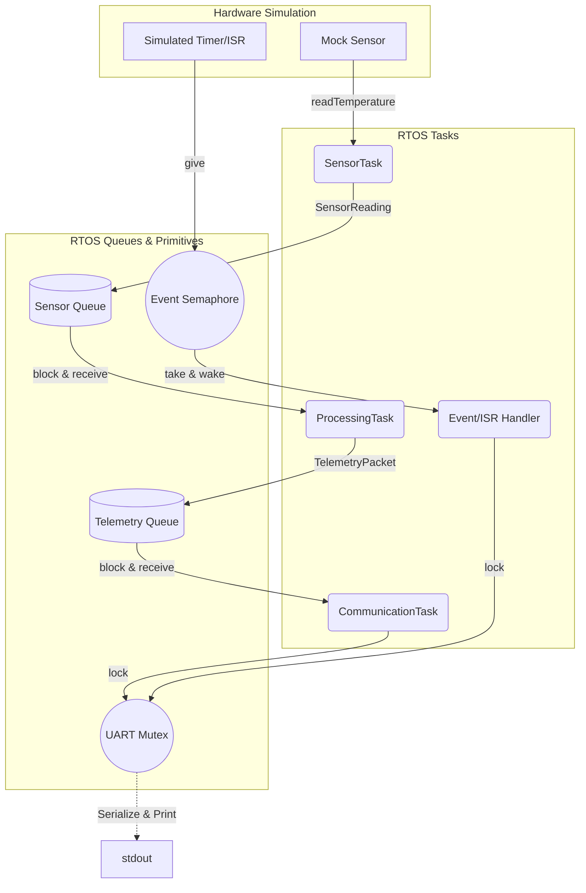

# Embedded Telemetry System 🚀


-orange.svg)

A robust, multi-threaded embedded telemetry platform designed for **Cortex-M microcontrollers (STM32)**. The system is currently running in a **FreeRTOS Simulation environment on PC**, providing a fully decoupled, event-driven architecture using standard C++11 concurrency primitives before porting to bare-metal/RTOS hardware.

## 📌 Current State

The project has successfully reached **Phase 22** of the development roadmap. At this stage, the business logic, task synchronization, and data pipelines are fully implemented and verified without requiring physical hardware.

**Key implementations include:**
- **FreeRTOS Simulation Layer**: Custom wrappers for `Task`, `Queue`, `Mutex`, and `Semaphore` to simulate RTOS behavior on x86/x64 systems.
- **Sensor Abstraction**: A mock temperature sensor generating normal readouts and injecting periodic anomalies (Warnings & Critical limits).
- **Telemetry Processing**: Dedicated logic to compute system status based on thresholds, packaging data into serialized telemetry strings.
- **Graceful Shutdown & Thread Safety**: Secure handling of thread terminations, preventing race conditions and blocking queues during teardown.
- **Structured Logging**: A thread-safe logger providing `[INFO]`, `[WARN]`, `[ERROR]`, and `[DEBUG]` traces.
- **Cross-Compilation Ready**: CMake toolchain file (`toolchain-arm-none-eabi.cmake`) configured for ARM Cortex-M4 targets.

## 🏗️ Architecture

The system utilizes an asynchronous Producer-Consumer pipeline, strictly separating responsibilities across independent tasks:



## 📂 Project Structure

```text
TelemetryCore/
├── app/                  # Application Layer
│   ├── include/          # App headers (tasks.h, telemetry.h)
│   └── src/              # Main logic, tasks definitions, processor
├── drivers/              # Hardware Abstraction Layer
│   ├── include/          # Driver interfaces (sensor.h)
│   └── src/              # Mock implementations
├── platform/             # Core OS and Platform utilities
│   ├── include/          # RTOS sim, Logger, Error Codes, Bit Utils
├── tests/                # Future unit tests
├── CMakeLists.txt        # Build system configuration
└── toolchain-*.cmake     # ARM GCC Cross-compilation toolchain
```

## 🛠️ Building and Running

The current environment targets native PC compilation for simulation purposes.

```bash
# 1. Configure the project
cmake -B build -DCMAKE_BUILD_TYPE=Release

# 2. Build the executable
cmake --build build

# 3. Run the simulation
./build/embedded_telemetry
```

## 🚀 Next Steps (Hardware Integration)

The upcoming phases (**Phase 23+**) will focus on bringing this architecture to a real **STM32 Microcontroller**.

- **STM32 Ecosystem**: Porting the `platform/rtos_sim.h` to native FreeRTOS via CMSIS-RTOS/HAL.
- **Hardware Drivers**: Replacing `MockTemperatureSensor` with an actual physical sensor via **I²C**.
- **Real UART & DMA**: Swapping the `std::cout` mock with direct UART transmission powered by Direct Memory Access (DMA) for non-blocking I/O.
- **Hardware Interrupts**: Wiring physical GPIO/Timer IRQs to replace the simulated ISR Task.
- **Watchdog & Fault Management**: Implementing hardware watchdogs to reset the MCU upon fatal deadlocks.
