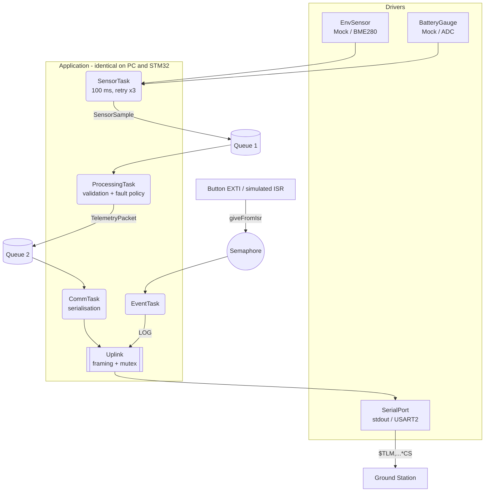

# Embedded Telemetry System 🚀


-orange.svg)

A multi-task embedded telemetry platform for **STM32 (Cortex-M4F) with FreeRTOS**. The same
application code runs in two places:

- on the **PC**, on top of a `std::thread` simulation of the RTOS (development, unit tests, CI);
- on a **NUCLEO-F446RE**, on top of the real FreeRTOS kernel and the STM32 HAL.

The board-independent part is finished and tested. The next step is running it on real hardware
(see [docs/ROADMAP_STM32.md](docs/ROADMAP_STM32.md)).

## 📌 Current State

| Area | Status |
|---|---|
| Application pipeline (4 tasks, 2 queues, ISR → semaphore) | ✅ PC + firmware |
| OS abstraction layer: host backend + native FreeRTOS backend | ✅ |
| Fault policy: retry → WARNING → CRITICAL, plausibility checks, fault flags | ✅ |
| Serial protocol with checksum (`BOOT` / `TLM` / `LOG` frames) | ✅ [docs/protocol.md](docs/protocol.md) |
| Unit + integration tests (GoogleTest), ground station tests | ✅ |
| STM32 firmware image (mock sensor, UART, LED, button) | ✅ builds, not yet run on a board |
| CI: tests, clang-tidy, cppcheck, clang-format, firmware artifacts | ✅ |
| Ground station (Python, terminal dashboard, CSV) | ✅ |
| Real BME280 sensor (I²C), ADC battery, watchdog, DMA | ⏳ milestones M7–M10 |

## 🏗️ Architecture



Layering rule: `app/` only sees the OSAL (`platform/include/osal/osal.h`) and the driver interfaces
(`drivers/include/`). It never includes HAL, FreeRTOS or `<thread>` directly — CI enforces it.

## 📂 Project Structure

```text
TelemetryCore/
├── app/                   # Application: tasks, acquisition, processing, uplink (portable)
├── platform/
│   ├── include/           # error codes, bit utils, logger, frame, osal/osal.h (RTOS API)
│   ├── osal_host/         # OSAL backend on std::thread (PC)
│   └── osal_freertos/     # OSAL backend on FreeRTOS (STM32)
├── drivers/
│   ├── include/           # EnvSensor, BatteryGauge, SerialPort interfaces
│   ├── mock/              # simulated sensor and battery (PC and STM32)
│   ├── host/              # stdout serial port
│   └── stm32/             # USART driver on the HAL
├── bsp/
│   ├── host/              # PC entry point (simulated interrupts and faults)
│   └── nucleo_f446re/     # clocks, pins, IRQs, linker script, FreeRTOSConfig.h, main.cpp
├── tests/                 # GoogleTest unit + integration tests
├── tools/ground_station/  # Python ground station
├── cmake/                 # ARM toolchain, pinned firmware dependencies
└── docs/                  # roadmap, protocol
```

## 🛠️ Building and Running

Requirements: CMake ≥ 3.21, Ninja, a C++17 compiler; for the firmware the
[Arm GNU Toolchain](https://developer.arm.com/downloads/-/arm-gnu-toolchain-downloads) (`arm-none-eabi-gcc`)
and an internet connection the first time (HAL, CMSIS and FreeRTOS are downloaded at pinned versions).

### PC simulation and tests

```bash
cmake --preset host-debug
cmake --build --preset host-debug
ctest --preset host-debug
./build/host-debug/bsp/host/telemetry_sim --duration-ms 5000
```

The simulator writes protocol frames to stdout, injects a failed read every 3 s and a 1.5 s sensor
outage every 15 s (`--no-faults` disables them, `--forever` runs until Ctrl+C).

### Ground station

```bash
./build/host-debug/bsp/host/telemetry_sim --forever | python tools/ground_station/ground_station.py --stdin
```

With the board connected (ST-LINK virtual COM port):

```bash
pip install -r tools/ground_station/requirements.txt
python tools/ground_station/ground_station.py --port COM5 --csv telemetry.csv
```

`--plain` prints one line per frame, `--check` prints a summary and fails on corrupted or lost frames.

### STM32 firmware (NUCLEO-F446RE)

```bash
cmake --preset stm32-release
cmake --build --preset stm32-release
```

Output in `build/stm32-release/bsp/nucleo_f446re/`: `telemetry_fw.elf`, `.hex`, `.bin`, `.map`.
Flash it with STM32CubeProgrammer (`STM32_Programmer_CLI -c port=SWD -w telemetry_fw.hex -rst`) or by
copying `telemetry_fw.bin` onto the NUCLEO USB drive. The green LED blinks at 1 Hz while the
scheduler runs; the user button B1 raises an external event.

## 🧪 Quality

- `-Wall -Wextra -Wpedantic -Wshadow -Wdouble-promotion ...` on project code, `-Werror` in CI
- clang-tidy profile in [`.clang-tidy`](.clang-tidy) (disabled checks are justified there)
- cppcheck, clang-format check
- zero heap on the firmware: static RTOS objects, `configSUPPORT_DYNAMIC_ALLOCATION 0`, `_sbrk` refuses to grow

## 🚀 Next Steps

Milestones M4–M11 in [docs/ROADMAP_STM32.md](docs/ROADMAP_STM32.md): first run on the board, UART
commands, BME280 over I²C, ADC battery, watchdog and fault injection, memory and real-time analysis, DMA.
